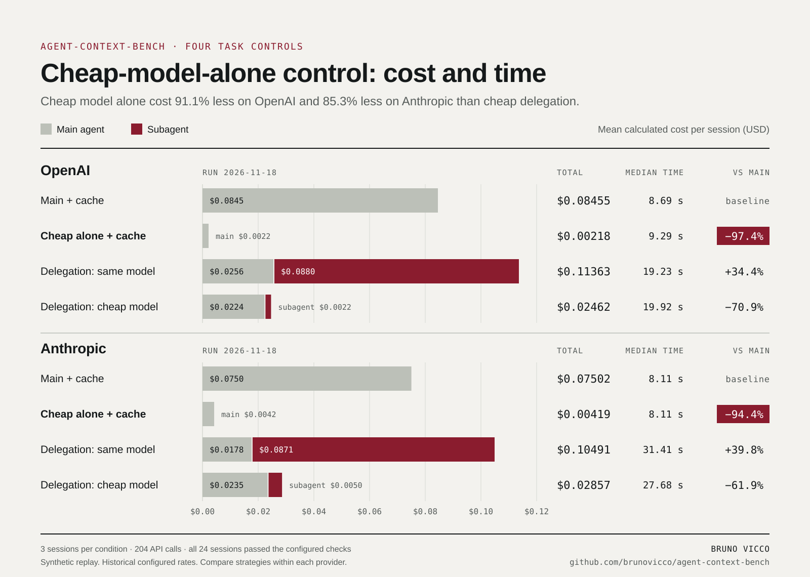
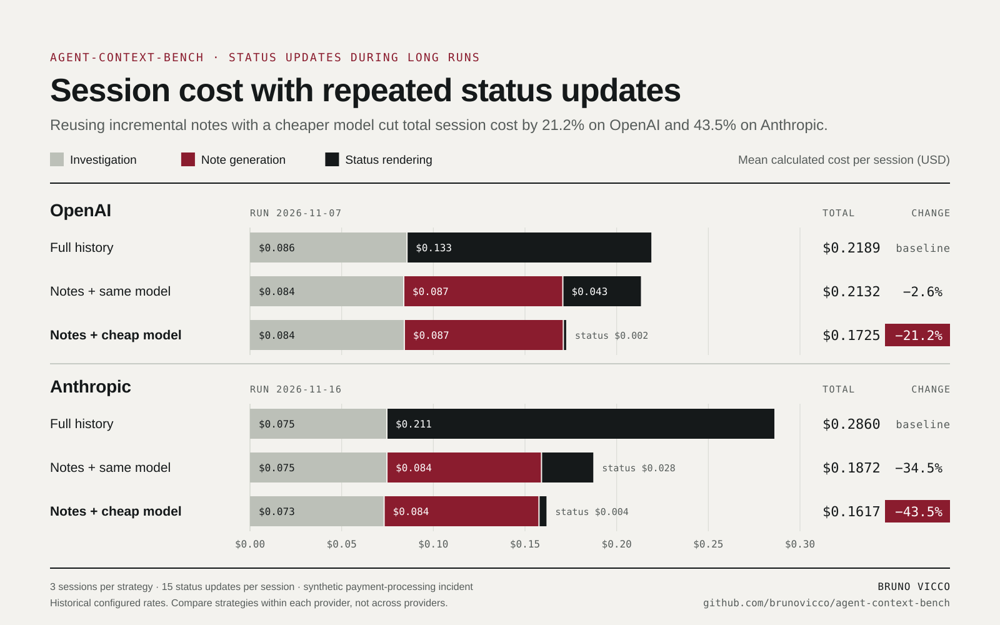

# agent-context-bench

**English** | [Português (Brasil)](README.pt-br.md)

**Measure the whole agent workflow: cost, context and time.**

A small Python CLI for controlled experiments with caching, summarization, delegation and
status updates through the official OpenAI and Anthropic SDKs. It accounts for every model
call and evaluates structured incident answers, using local JSONL/CSV files and optional telemetry.

**Latest finding:** in the synthetic incident replay, the cheap model alone passed the same
configured checks and was cheaper and faster than cheap delegation on both providers.

[Latest results](#latest-results-the-cheap-model-alone-control) · [Quick start](#quick-start-offline) ·
[How it works](#how-it-works) · [Method](#method-and-limitations) ·
[Evidence](#public-evidence-and-engineering-contribution) · [Development](#development)

## Latest results: the cheap-model-alone control



Adding the standalone control changes the interpretation: **the cheap model alone cost
91.1% less than cheap delegation on OpenAI and 85.3% less on Anthropic**, while also
finishing faster than that delegation flow. Every condition passed the configured checks
in 3/3 sessions.

| Strategy | OpenAI · USD/session | Median time | Anthropic · USD/session | Median time |
| --- | ---: | ---: | ---: | ---: |
| Main model + cache | 0.08455 | 8.69 s | 0.07502 | 8.11 s |
| **Cheap model alone + cache** | **0.00218** | **9.29 s** | **0.00419** | **8.11 s** |
| Delegation to the same model | 0.11363 | 19.23 s | 0.10491 | 31.41 s |
| Delegation to a cheap model | 0.02462 | 19.92 s | 0.02857 | 27.68 s |

**Measured on November 18, 2026:** 204 API calls, 24 sessions, no API errors, and
USD 1.31303 in total calculated cost. Costs include both agent roles. Session time includes
the entire sequential workflow. Cache reads and complete usage were observed in both runs.
Source: [full results CSV](benchmarks/controls-validation.csv) ·
[sanitized evidence](benchmarks/controls-evidence).

The cheap standalone model saved 97.4% and 94.4% against the cached main model,
respectively. Cheap delegation took 2.14× and 3.41× as long as the cheap standalone model.
The standalone model was slightly slower than the cached main model on OpenAI; Anthropic
medians both round to 8.11 seconds. These are observed medians, not established speed rankings.

**Interpretation:** this replay does not demonstrate a benefit from combining two models
over using the cheap model alone. Three repetitions of one synthetic evidence-preservation
task do not establish generalization or equivalent quality on other tasks. Passing the
configured checks is narrower than proving the entire answer correct.

<details>
<summary>Models, evaluation, cache and offline reproduction</summary>

| Provider | Main model | Cheap model | Observed cache read/input: main alone / cheap alone |
| --- | --- | --- | ---: |
| OpenAI | `gpt-5.6-sol` | `gpt-6-luna` | 75.03% / 75.03% |
| Anthropic | `claude-sonnet-5-5` | `claude-haiku-5-5` | 74.93% / 74.94% |

Requested and returned model strings matched in all 204 calls. These aliases do not
identify immutable model snapshots. Cache fractions count input tokens across requests,
including ordinary input, cache reads and cache writes. They describe these flows and
conditions, not a general provider property.

All four conditions were rerun in randomized blocks under schema 4 and the stronger
`evidence-v2` evaluator: distinct string IDs, allowed causal support and temporal availability.
The original replay supplies the cause explicitly and labels unrelated logs. It measures
retention of identifiers, corrections and approval constraints, with little causal discovery.
The status controls, `final_only` schedule and additional scenarios have not been measured live.

Configured rates retain their November 6 date; the same prices were checked against official
sources on November 18, as recorded in [provenance.json](benchmarks/controls-evidence/provenance.json).
Costs are calculated from those rates, not reconciled with provider invoices. New runs are
kept separate from earlier batches and are not pooled across evaluator revisions.

```bash
uv run python scripts/reproduce_controls.py
# Optional: keep a rebuilt CSV in a new directory
uv run python scripts/reproduce_controls.py --output /tmp/controls-tables-NEW
```

This verifies checksums, model routing, the full call schedule, normalized usage, configured-rate
costs and exact CSV agreement. It reuses saved boolean judgments and cannot reevaluate answers
that were never retained. The sanitized bundle contains no prompts, answers or telemetry IDs.

</details>

## Quick start (offline)

```bash
uv sync --frozen
uv run context-bench demo --output results/demo-NEW
uv run python scripts/reproduce_controls.py
uv run python scripts/reproduce_benchmarks.py
```

The demo uses fixed responses and does not measure performance. The reproduction scripts verify
two current control runs and eight earlier runs, rebuilding four CSVs without credentials or API calls.
Use a new output directory for every demo.

## How it works

The original scenario is a synthetic payment-incident replay testing evidence preservation. Evidence
arrives over five turns: an initial hypothesis, its correction, the identified cause,
and two sandbox checks. The sixth turn requests a JSON answer. Irrelevant logs
progressively increase the context.

Evaluation checks five items: cause, action, human approval requirement, discarded
hypothesis, and causal evidence. New runs require distinct string evidence IDs that are
causally relevant and already available, including all required causal references.
The earlier schema-3 runs used a check requiring a list containing E3; their saved
verdicts are preserved, not upgraded retroactively. It uses deterministic rules, without
an LLM judge. Expected values come from the evidence; the system prompt describes the
format without providing the answer key.

| Strategy | What changes | Calls per session |
| --- | --- | ---: |
| `full` | Full history with caching disabled for the control | 6 |
| `cache` | Full history with caching enabled | 6 |
| `cache_small_model` | Full history and cache, with the alternative model solving the task alone | 6 |
| `summary` | One summary call replaces the history after three turns; caching enabled | 7 |
| `delegate_same_model` | A subagent keeps the raw evidence; the main agent receives notes; both use the same model | 11 |
| `delegate_small_model` | The same delegation flow, using a different model for the subagent | 11 |

There is one subagent. It maintains its own history and receives only evidence that has
already been released. Each turn, it produces notes of up to 200 words: a prompt instruction,
not a limit enforced through local truncation. The main agent receives these notes as data,
maintains its history, and answers the final turn. Both use the same cache policy.
Neither agent executes actions or accesses real tools.

### The answer format is part of the experiment

One diagnostic run returned `retry_storm` and `database_latency` with explanations appended.
The information was present, but the fields failed exact matching. Another answer was not
valid JSON; the available diagnostic does not reveal its form.

The output contract was updated to require identifiers without explanations and a JSON
object without Markdown. The instruction was applied to all providers and strategies,
while keeping evaluation strict. The baselines were rerun. Results before and after
this change must therefore be analyzed as separate batches.

## Earlier cache and delegation experiments

<details>
<summary>Original results, interpretation and provenance</summary>

## Cache and summarization: original experiment

| Provider | Strategy | Total USD, 3 sessions | Savings versus full | Median session time | Passed |
| --- | --- | ---: | ---: | ---: | ---: |
| openai | `cache` | 0.2576734 | 59.28% | 11.59 s | 3/3 |
| openai | `full` | 0.6328240 | 0.00% | 9.61 s | 3/3 |
| openai | `summary` | 0.2558794 | 59.57% | 15.38 s | 3/3 |
| anthropic | `cache` | 0.2168504 | 62.98% | 11.70 s | 3/3 |
| anthropic | `full` | 0.5857420 | 0.00% | 13.16 s | 3/3 |
| anthropic | `summary` | 0.2351411 | 59.86% | 17.19 s | 3/3 |

Source: [cache-validation.csv](benchmarks/cache-validation.csv), `openai-validation-01`
and `anthropic-validation-01`, dated 2026-11-06, 57 calls per provider. Cache saved 59.28%
and 62.98% versus uncached history. Summarization saved only 0.70% versus cache on OpenAI
and cost 8.43% more on Anthropic. Three repetitions do not establish an advantage for
OpenAI's small difference. Costs include generating the summary.

These runs use scenario hash
`883044d6839c213467631deda8879749bb35eedb36c743eacb63a2225a582c32`, before the JSON
contract revision. They are not pooled with later delegation/status controls.
Rates are historical inputs, recorded in the published manifests.

## Pilot results

Costs are calculated from the configured rates. Time is the median for the entire session,
including delegation calls. The `cache` condition is the baseline within each provider.

| Provider | Strategy | USD per successful task | Cost change | Median time | Passed |
| --- | --- | ---: | ---: | ---: | ---: |
| OpenAI | Cache | 0.08477 | - | 9.75 s | 3/3 |
| OpenAI | Subagent using the same model | 0.11160 | +31.6% | 19.59 s | 3/3 |
| OpenAI | Cheaper subagent | **0.02266** | **−73.3%** | 19.38 s | 3/3 |
| Anthropic | Cache | 0.07313 | - | 10.21 s | 3/3 |
| Anthropic | Subagent using the same model | 0.11039 | +51.0% | 32.69 s | 3/3 |
| Anthropic | Cheaper subagent | **0.02470** | **−66.2%** | 24.28 s | 3/3 |

Configured models: GPT-5.6 Sol with GPT-6 Luna on OpenAI; Claude Sonnet 5.5 with
Claude Haiku 5.5 on Anthropic. The same-model variant uses the main model in both roles.
These names identify the models requested in the configurations, not verified returned versions.

Together, the two runs recorded **168 calls**, 18 sessions, and **USD 1.28175** in calculated
cost. Complete usage accounting and valid cache controls were reported for every condition.

### What the numbers show

- **Less context in the main agent does not imply an equal reduction in cumulative input tokens.**
  With the cheaper subagent, cumulative main-agent input tokens fell by 93.2% on OpenAI
  and 85.8% on Anthropic. Across both roles, the reductions were 18.0% and 8.7%.
- **The model used for delegation matters.** Delegating to the same model cost more than
  the baseline. Savings appeared with the cheaper model; the model swap was not isolated from changes
  in output length, notes, answers, or observed cache behavior.
- **There is a time cost.** Delegation in this experiment is sequential: each turn waits
  for the subagent before calling the main agent. A session makes 11 calls, versus 6 in the baseline.
- **Enabling caching does not guarantee cache reads.** On OpenAI, the main agent in the
  delegated variants reported no cache reads; its subagents reached approximately 66.6%.
  Short notes can reduce opportunities for cache reuse.

Example calculation using the total costs of the three repetitions:

```text
OpenAI:    (1 − 0.0679741 / 0.2543148) × 100 = 73.3%
Anthropic: (1 − 0.07409805 / 0.2193878) × 100 = 66.2%
```

The published values are in [benchmarks/delegation-validation.csv](benchmarks/delegation-validation.csv).
Aggregates can be rebuilt from the sanitized evidence committed under
[benchmarks/evidence](benchmarks/evidence).
Earlier runs using a different output contract are excluded from this table.

</details>

## Status update experiment (v0.3.0)



Historical status experiment: three updates per note snapshot.
At this reuse level, notes + cheap rendering saved 21.2% of whole-session cost on OpenAI
and 43.5% on Anthropic. These measurements predate the new status controls; compare strategies
within each provider. With one update on OpenAI, generating notes more than offset the rendering savings.

<details>
<summary>Status methodology, results and reproduction</summary>

This experiment compares the cost of producing status updates from the main agent's full
conversation history versus short working notes. The main agent still runs the same six-turn
incident investigation in every condition. Notes and status responses never enter its history.

| Strategy | Status input | Status model | Calls per session, with one update per point |
| --- | --- | --- | ---: |
| `status_full_history` | All main-agent user/assistant messages received so far | Main model | 6 task + 5 status = 11 |
| `status_notes_same_model` | Latest incremental notes | Main model | 6 task + 5 notes + 5 status = 16 |
| `status_notes_small_model` | Latest incremental notes | `[subagent].model` | 6 task + 5 notes + 5 status = 16 |

The notes generator always uses the main model and its rates in both notes conditions.
It receives the previous notes and only the latest task exchange, and must produce at most
200 words. The prompt targets about 150 words, with shorter notes allowed, to leave room
below the hard limit. Notes are generated once per observation point and reused for repeated updates
at that point. Their generation cost is included. Outputs are not truncated to meet the limit.
Both notes conditions use the same prompts and settings; model outputs can vary between sessions.

Status generation has its own isolated context and a common prompt across the three conditions.
It returns JSON containing the latest evidence ID, confirmed cause (or null), discarded
hypothesis (or null), human approval requirement, and a status description of at most 40 words.
The common status prompt targets about 25 words; this is guidance, not a new validation limit.
Checks validate those structured facts against the current observation point, and check the
text's presence and length. They do not evaluate the free text's full semantic quality.
No status response becomes input to a later update. Cache is enabled for task, note, and status
calls, with the existing provider policy and isolated prefixes per session/role.

**Timing:** updates run sequentially after each of the five evidence turns, before the final
answer. `status_updates_per_turn` controls how many updates use each snapshot (default 1,
integer from 1 to 20). There is no wall-clock scheduler, 30-second wait, or concurrent execution.
Increasing this setting measures repeated observations of unchanged evidence; cache behavior
and elapsed time may differ from a real background agent. This is an application experiment,
not a reproduction of Claude Code internals or a measurement of subscription usage limits.

The final task and every scheduled status update must pass, and notes must meet the size limit,
for a session to count as `passed`. `task_passed` separately counts correct final task answers;
`status_pass_rate` covers expected updates, including those missing after an interruption.
Structured checks for notes/status appear in `calls.jsonl` without their text.
Note calls also record `notes_text_diagnostics`: `text_nonempty`, `text_word_count`, and
`text_within_limit`, using `split()` and the unchanged 200-word limit. These metadata are
recorded for returned responses, including incomplete ones, without saving the notes.
Status calls also record `status_text_diagnostics`: `text_present`, `text_is_string`,
`text_nonempty`, `text_word_count`, and `text_within_limit`. These metadata are always
recorded for returned responses, including incomplete ones; no response text is saved.
The word count uses `split()` and is null for missing or non-string fields. Empty strings
have zero words and meet the size limit, but still fail the nonempty check. Invalid JSON
or a non-object response is treated as missing fields. The 40-word limit and approval
checks are unchanged. Existing runs cannot recover these metadata retroactively. `--diagnostics`
continues to apply only to the main agent's final answer. API errors stop the run; incomplete
or empty auxiliary responses stop the current session and retain known usage.

The 150/25-word prompt targets change `status_prompt_sha256` in the manifest. Keep prior
runs, including failures, and use new output directories for this revision. Compare all three
conditions with the same prompt revision; do not pool different hashes as one experiment.
No automatic retry or truncation is added. The completed runs below use the revised prompts.

| Report field | Meaning |
| --- | --- |
| `workload_cost_usd` | Main investigation calls |
| `notes_cost_usd` | Incremental note generation |
| `status_cost_usd` | Status rendering calls only |
| `status_update_cost_mean_usd` | Average cost per attempted status rendering call |
| `status_pipeline_cost_usd` | Notes plus status rendering |
| `total_cost_usd` / `session_cost_mean_usd` | All calls, as a run total / mean per started session |
| `status_overhead_fraction` | Share of total cost spent on notes and status |
| `status_update_savings_fraction` | Rendering cost reduction versus `status_full_history` |
| `status_pipeline_savings_fraction` | Notes + rendering cost reduction versus `status_full_history` |
| `session_savings_fraction` | Total session cost reduction versus `status_full_history` |
| `cost_per_passed_task_usd` | All attempted-call costs divided by fully passed sessions (`passed`), not only correct final answers (`task_passed`); legacy field name |

Savings are fractions: `0.25` means 25% less, negative values mean more expensive. They are
reported only for a completed run with all planned repetitions, equal session/update counts,
all sessions passing, and known comparison costs with a positive baseline. Otherwise they
are `null`. A cheaper update does not necessarily mean a cheaper session. Partial runs must
not be compared as completed workloads, even when their partial costs are known.

The manifest records `status_prompt_sha256`, the schedule, and update count. Schema version 3
adds these metrics while keeping older JSONL reports readable. Delegation results above
remain a separate experiment.

### Audited live status results

[Consolidated CSV](benchmarks/status-validation.csv) contains 12 conditions from four
completed runs. Each run has three repetitions of each strategy: **9/9 sessions passed**,
with **45/45 status updates at `k = 1`** or **135/135 at `k = 3`**. Each run generated
30 notes and made 129 or 219 calls, respectively. Across these runs: 696 calls,
36 passed sessions, 360 passed updates, and 120 note generations. `synthetic: false`
means real API calls; the incident itself remains synthetic.

Sources are the local `manifest.json`, `calls.jsonl`, and `sessions.jsonl` in:

| Provider | Updates per turn | Source directory under `results/` | Date (UTC) |
| --- | ---: | --- | --- |
| OpenAI | 1 | `openai-status-length-validation-01` | 2026-11-07 |
| Anthropic | 1 | `anthropic-status-length-validation-01` | 2026-11-07 |
| OpenAI | 3 | `openai-status-reuse3-03` | 2026-11-07 |
| Anthropic | 3 | `anthropic-status-reuse3-03` | 2026-11-16 |

All four use status prompt SHA-256
`ec1cbb883ff80e79b5883d0fb88ba8b47f50d8e4f4776252b776337075d2326b`
and scenario SHA-256
`1fec88977685fae92acf8800484af594e3ddded0c1a74b21ecfd89fbd7561de5`.
The default replay and legacy text-note prompts still match both hashes. New evaluator
hashes and schema-4 manifests distinguish the stronger checks from the published verdicts. Configurations match their manifests: seed 42,
2,048 output tokens, 60-second request timeout, three repetitions, SDKs OpenAI 2.54.0
and Anthropic 0.125.0. Requested and returned model strings match in every recorded call;
these aliases do not establish immutable model versions.

Configured USD per million tokens, dated **2026-11-06**, reproduced here as historical
experiment inputs rather than a current price quotation:

| Provider / role | Model | Ordinary input | Cache read | Cache write (total) | Output |
| --- | --- | ---: | ---: | ---: | ---: |
| OpenAI main / notes | `gpt-5.6-sol` | 4 | 0.4 | 5 | 20 |
| OpenAI cheap status | `gpt-6-luna` | 0.1 | 0.01 | 0.125 | 0.5 |
| Anthropic main / notes | `claude-sonnet-5-5` | 2 | 0.1 | 2.5 | 10 |
| Anthropic cheap status | `claude-haiku-5-5` | 0.1 | 0.01 | 0.125 | 0.5 |

Raw usage normalization and every recorded call cost were checked against these rates.
Usage is complete, all calls requested cache, and cache controls are valid throughout.
OpenAI uses explicit Responses breakpoints in the system/developer content and user
messages, with a 30-minute TTL; Anthropic sends automatic ephemeral caching with a
five-minute TTL. This policy is the same across all three status strategies, including
notes and task calls. A cache request does not imply a hit. In the full-history **status
calls only**, observed read/input fractions were 66.707118% (OpenAI, `k = 1`), 0%
(Anthropic, `k = 1`), 88.860982% (OpenAI, `k = 3`), and 66.648076% (Anthropic, `k = 3`).
The denominator includes ordinary input, cache reads, and cache writes; it counts tokens
across requests, not unique context. Per-condition cache and token totals are in the CSV.

**One update per evidence turn (`k = 1`):**

| Provider | Strategy | Total USD, 3 sessions | Mean USD/session | Median session time |
| --- | --- | ---: | ---: | ---: |
| OpenAI | Full history | 0.5061482 | 0.168716067 | 20.84 s |
| OpenAI | Notes, same model | 0.5489598 | 0.182986600 | 33.67 s |
| OpenAI | Notes, cheap model | 0.5165627 | 0.172187567 | 38.40 s |
| Anthropic | Full history | 0.7795653 | 0.259855100 | 17.65 s |
| Anthropic | Notes, same model | 0.5255119 | 0.175170633 | 37.98 s |
| Anthropic | Notes, cheap model | 0.47431685 | 0.158105617 | 38.02 s |

**Three updates sharing each snapshot (`k = 3`):**

| Provider | Strategy | Total USD, 3 sessions | Mean USD/session | Median session time |
| --- | --- | ---: | ---: | ---: |
| OpenAI | Full history | 0.6567402 | 0.218913400 | 36.91 s |
| OpenAI | Notes, same model | 0.6396958 | 0.213231933 | 42.75 s |
| OpenAI | Notes, cheap model | 0.5173699 | 0.172456633 | 55.68 s |
| Anthropic | Full history | 0.8580869 | 0.286028967 | 44.65 s |
| Anthropic | Notes, same model | 0.5617414 | 0.187247133 | 62.30 s |
| Anthropic | Notes, cheap model | 0.485141845 | 0.161713948 | 64.53 s |

Every comparison below uses `1 - strategy_cost / full_history_cost` within the same
provider and update count. Positive percentages mean savings; negative ones mean extra cost.

| Provider | Updates/turn | Notes strategy | Status rendering savings | Notes + status savings | Whole-session savings |
| --- | ---: | --- | ---: | ---: | ---: |
| OpenAI | 1 | Same model | 83.487117% | −17.423849% | −8.458313% |
| OpenAI | 1 | Cheap model | 99.407986% | −3.482398% | −2.057599% |
| Anthropic | 1 | Same model | 91.781068% | 46.201803% | 32.589111% |
| Anthropic | 1 | Cheap model | 99.125974% | 53.930846% | 39.156239% |
| OpenAI | 3 | Same model | 68.039085% | 2.946856% | 2.595303% |
| OpenAI | 3 | Cheap model | 98.834827% | 33.768857% | 21.221527% |
| Anthropic | 3 | Same model | 86.635873% | 46.747130% | 34.535605% |
| Anthropic | 3 | Cheap model | 98.066242% | 58.099438% | 43.462388% |

Note generation is a substantial cost, even when status rendering is very cheap.
For OpenAI at `k = 1`, status rendering fell from USD 0.2538624 to 0.0015029,
but generating notes cost USD 0.2612. Notes more than offset the rendering savings;
the whole-session total increased from USD 0.5061482 to 0.5165627 (about 2.1%).
For `k = 3`, the composition of the three-session total is:

| Provider | Strategy | Investigation USD | Notes USD | Status USD |
| --- | --- | ---: | ---: | ---: |
| OpenAI | Full history | 0.2568768 | 0 | 0.3998634 |
| OpenAI | Notes, same model | 0.2516158 | 0.2602800 | 0.1278000 |
| OpenAI | Notes, cheap model | 0.2525358 | 0.2601750 | 0.0046591 |
| Anthropic | Full history | 0.2239669 | 0 | 0.6341200 |
| Anthropic | Notes, same model | 0.2240543 | 0.2529425 | 0.0847446 |
| Anthropic | Notes, cheap model | 0.2194420 | 0.2534375 | 0.012262345 |

The absent notes operation costs zero; an attempted call with missing accounting remains
`null`. Each notes condition generates 15 notes across its three sessions at either `k`.
Amortized note cost per update is `notes_cost / (15 × k)`; for the cheap-model condition,
it falls from USD 0.0174133 to 0.0057817 on OpenAI and from USD 0.0167460 to 0.0056320
on Anthropic between these runs. Note outputs and main-task costs vary, so the realized
session saving is measured separately. On OpenAI, sharing each note three times changed
both notes conditions from extra cost to savings against the corresponding control.
Executing more updates did **not** reduce absolute session cost: compare each strategy
with the full-history control at the same `k`. Rendering savings near 99% are not session
savings. Median sequential session time increased with notes in every comparison;
at `k = 3`, cheap-model notes took 55.68 versus 36.91 seconds on OpenAI and 64.53 versus
44.65 seconds on Anthropic. These measurements include serial note/status generation,
network time, and local overhead; they do not isolate model speed or predict concurrency.

### Failure history and limits

Earlier prompts violated size constraints. For example, `anthropic-status-validation-01`
passed 7/9 sessions with two failed status-text checks and one failed note-word-limit check.
Those runs retain the earlier prompt hash and are excluded from the consolidated CSV.
The revised prompts passed all four completed runs without relaxing the 40/200-word limits,
truncating outputs, or retrying for quality. This is a small pilot, not proof of reliability.

Interrupted attempts remain in `results/`. OpenAI `reuse3-01` and `reuse3-02` record
`APIError`; the user reported insufficient balance and recharging. The user also reported
insufficient Anthropic balance, a later failed attempt, and a successful minimal call.
Local Anthropic files differ from the supplied narrative: `reuse3-01` records
`BadRequestError` (160 calls, 7 started sessions), while `reuse3-02` records
`APITimeoutError` (141 calls, 6 started sessions), rather than a quick `BadRequestError`
in `02`. The saved error classes cannot establish the underlying causes, and no exception
messages were retained. Missing updates after interruption are schedule shortfalls,
not observed model-content failures. Unknown costs remain `null`.

All four complete source sets are present. Original results stay local and ignored by Git; sanitized accounting and evaluation
records are available under [benchmarks/evidence](benchmarks/evidence). Configured-rate costs are not a reconciliation with provider invoices.
The `k = 3` provider runs occurred nine days apart; model aliases, service variation,
and execution conditions further limit direct comparisons. These results do not establish
an OpenAI-versus-Anthropic ranking, reproduce Claude Code internals, or measure subscriptions.
In these published runs, only structured status fields and description size were checked;
note semantics and the full semantic quality of free-text status descriptions were not evaluated.
New structured notes add snapshot-fact checks; LLM-rendered status prose still has no
semantic-coherence score. The deterministic template avoids independently generated prose.

### Reproduce reports or run a new comparison

Regenerate the public CSV offline from explicitly selected local source runs, then compare
it with the committed result:

```bash
uv run context-bench consolidate \
  results/openai-status-length-validation-01 \
  results/anthropic-status-length-validation-01 \
  results/openai-status-reuse3-03 \
  results/anthropic-status-reuse3-03 \
  --output /tmp/status-validation-recomputed.csv
diff -u benchmarks/status-validation.csv /tmp/status-validation-recomputed.csv
```

The output path must be new. `consolidate` reads schema-3 live status runs and validates
completed manifests, planned repetitions, session associations, and the full task/note/status
call schedule. Missing files, interrupted runs, incomplete responses, and missing or duplicate
scheduled calls fail before creating the CSV. Session approval flags and status pass counts
must agree with the saved boolean checks; contradictory or malformed quality metadata is
rejected. Existing source files, including `summary.csv`, are never rewritten. Every run keeps
its own baseline, provider, update count, model aliases, and hashes; runs are not pooled, even when supplied in the same command. Completed sessions
with failed quality checks can be exported, with no savings claimed for those conditions.
Unknown costs are written as `null`. This reuses recorded costs and evaluation results;
it does not reprice calls or reevaluate answers that were never retained.

Recompute existing local reports without API calls:

```bash
uv run context-bench report results/openai-status-length-validation-01
uv run context-bench report results/anthropic-status-length-validation-01
uv run context-bench report results/openai-status-reuse3-03
uv run context-bench report results/anthropic-status-reuse3-03
```

For a separately authorized paid reproduction, use the committed `*-status-validation.toml`
(`k = 1`) or `*-status-reuse3.toml` (`k = 3`) configuration and a **new** output directory:

```bash
uv run --env-file .env context-bench run \
  --config configs/openai-status-validation.toml --output results/openai-status-validation-NEW --live --diagnostics
uv run --env-file .env context-bench run \
  --config configs/anthropic-status-validation.toml --output results/anthropic-status-validation-NEW --live --diagnostics
uv run --env-file .env context-bench run \
  --config configs/openai-status-reuse3.toml --output results/openai-status-reuse3-NEW --live --diagnostics
uv run --env-file .env context-bench run \
  --config configs/anthropic-status-reuse3.toml --output results/anthropic-status-reuse3-NEW --live --diagnostics
```

Each validation configuration plans 129 calls; each reuse configuration plans 219 calls.
The shorter `*-status.toml` examples use one repetition and plan 43 calls. In general,
the three strategies make `28 + 15 × k` calls per repetition. `--diagnostics` is optional
and saves only bounded evaluated final fields from this synthetic incident. Check historical
model availability and rates before any paid run; do not reuse an existing output directory.

</details>

<details>
<summary>Configuration reference: task controls, status, schedules and scenarios</summary>

## New controlled comparisons (schema 4)

The four task controls were measured in the latest results above. Status controls,
the final-only schedule and additional scenarios are implemented and tested offline,
but remain unmeasured live. The earlier delegation pilot lacked the standalone cheap-model
control; its results do not establish delegation as the best available architecture. The original replay supplies the cause explicitly, labels irrelevant logs,
and asks mainly for acknowledgements followed by evidence preservation, rather than
open-ended causal discovery. In the full-history versus summarization experiment,
caching accounted for nearly all the observed savings; OpenAI's additional 0.70% is an
observed difference from three repetitions, not an established advantage.

| Task strategy | Raw evidence model | Final answer model | Calls/session: every turn / final only |
| --- | --- | --- | ---: |
| `cache` | Main | Main | 6 / 1 |
| `cache_small_model` | Alternative | Alternative | 6 / 1 |
| `delegate_same_model` | Main subagent | Main | 11 / 6 |
| `delegate_small_model` | Alternative subagent | Main | 11 / 6 |

`[subagent]` configures the alternative model and its own rates, including when it acts
as the sole task model. This name does not imply that every alternative-model call is a
subagent call: `cache_small_model` is billed under `main`. Model names and dated prices
in the new example TOMLs are historical inputs copied from the pilot, not current quotes.

For a new, explicitly authorized paid run, choose one config and a new output directory:

```bash
uv run --env-file .env context-bench run \
  --config configs/openai-controls.toml --output results/openai-controls-NEW --live
```

Use `anthropic-controls.toml` for the other provider. Each config schedules three repetitions
of all four conditions: 102 calls per provider. `*-decision-controls.toml` runs the same
conditions with `task_schedule = "final_only"`: 42 calls per provider. All five raw evidence
turns accumulate before the final task call. Delegates still update a brief after each
released evidence turn, and the main agent receives all five briefs in order. There are no
fabricated assistant acknowledgements. This compares calling schedules, not autonomous
intermediate decision-making. `summary` requires `every_turn`.

The `*-status-controls.toml` configs compare six conditions under the same structured-note
contract, using `notes_format = "structured"`:

| Strategy | Status context | Notes model | Renderer |
| --- | --- | --- | --- |
| `status_full_history` | Full history | — | Main model |
| `status_full_history_small_model` | Full history | — | Alternative model |
| `status_notes_same_model` | Notes | Main | Main model |
| `status_notes_small_model` | Notes | Main | Alternative model |
| `status_notes_template` | Notes | Main | Local template |
| `status_small_notes_small_model` | Notes | Alternative | Alternative model |

At one update per evidence turn, these schedule 243 API calls and 15 local template events
per provider over three repetitions. At three updates per turn they schedule 393 API calls
and 45 local events. Notes are produced once per evidence turn, not once per update.
To test other schedules, copy the config and set `task_schedule = "final_only"` (153 calls
at one update), or change `status_updates_per_turn`; keep matching controls in the new run.
`status_baseline` explicitly names the status comparison baseline, defaulting to
`status_full_history`. Missing or unsuccessful baselines produce null savings.

Structured notes contain `latest_evidence`, `cause`, `discarded_hypothesis`,
`approval_required`, and distinct received `evidence` IDs. They must preserve the current
snapshot facts and required causal references within the 200-word limit. Invalid or
truncated structured notes stop that session without repair or fallback; the billable call
and failed checks remain recorded. Subsequent conditions can still run. Legacy `text` notes
remain available, with only nonempty/word-limit checks. Do not pool text-note runs with
structured-note runs: changing representation is itself an intervention.

The local template reads only note fields. It cannot access expected answers, raw evidence,
or a turn-index lookup. It describes the cause, discarded hypothesis, and approval requirement
without making independent execution claims. It makes no API call. `observations.jsonl`
records only its agenda, timing and boolean checks, with no text, usage, prices or cache fields.
Local time is included in session elapsed time; `status_latency_*` continues to describe
LLM calls only. Rendering has zero API cost; unknown note-generation cost still makes the
pipeline and session cost null. No model-generated prose is assumed semantically correct
merely because the structured fields and word limit pass.

New manifests record schema 4, evaluator version and source hashes, scenario hash,
notes/status prompt hash, randomized condition order, and models and scheduled turns per role.
`summary.csv` includes model routing, notes format, agenda, evaluator hashes, local event count,
status savings against `status_baseline`, and `task_savings_vs_cache_fraction` for the four
task controls. Percentages require a completed, valid schedule, successful sessions, known
costs, complete usage and valid cache controls. Cache hits remain measured from API counters.
A valid cache policy alone does not establish cache hits.

```bash
uv run context-bench consolidate results/openai-controls-NEW \
  --output /tmp/openai-controls-NEW.csv
```

Offline consolidation accepts new task/status subsets and validates model routing, exact
call/local-event schedules, associations and saved boolean verdicts. It preserves source
files. It also retains schema-3 status export compatibility; exporting only legacy sources
keeps the historical CSV columns exactly. Mixed exports add provenance columns, with unknown
legacy evaluator metadata left null. Runs are never pooled across scenarios, rubrics,
providers, formats or schedules. The public reproduction script still reconstructs the same
eight historical runs and three tables. It reuses recorded judgments; discarded responses
cannot be rescored under the new evaluator.

Additional fixed scenarios have their rubrics defined in code before any new paid execution:

| `scenario` | Change | Required final causal references |
| --- | --- | --- |
| `replay` | Original preservation task | E3 |
| `ambiguous` | Config change and concurrent traffic surge; confirmation only at E4 | E3, E4 |
| `corrections` | Preliminary conclusion withdrawn at E4 and corrected at E5 | E5 |
| `dense` | Exact action identifier revised; both approval gates remain pending | E3 |

Use `*-ambiguous-controls.toml`, `*-corrections-controls.toml`, or `*-dense-controls.toml`.
Each runs the four task controls with three repetitions (102 calls). To compare status on a
variant, copy a status-controls config and change `scenario`. Variant diagnostic records are
not explicitly labeled irrelevant. These are still small synthetic tests with explicit final
conclusions; the `dense` variant tests exact constraint retention, not a general bound on
compressibility. Repetitions should be expanded only after assessing these controls, with
rubrics and reporting rules fixed before live execution.

</details>

## Run it

Requirements: Python 3.13 or 3.14 and `uv`. The core uses official SDKs and local files;
it does not require a server, database, or agent framework.

### Start without credentials

```bash
uv sync --frozen
uv run context-bench demo --output results/demo-01
uv run context-bench report results/demo-01
```

The demo uses fixed responses, zero token counts, and null costs. It checks the installation
and file workflow; it does not measure model performance or quality.

### Run against the APIs

Set `OPENAI_API_KEY` and/or `ANTHROPIC_API_KEY` in the environment or a local `.env` file.
Check model availability in your account and the rates in `configs/` before using `--live`.
The example rates are dated snapshots, not a current pricing lookup.

For three repetitions of the four task controls:

```bash
uv run --env-file .env context-bench run \
  --config configs/openai-controls.toml \
  --output results/openai-controls-NEW --live

uv run --env-file .env context-bench run \
  --config configs/anthropic-controls.toml \
  --output results/anthropic-controls-NEW --live
```

These configurations schedule 102 calls per provider. They include the cheap model alone,
with the same scenario, cache policy and output contract as the other conditions.
Always use a new output directory. The earlier three-condition configs remain available
as `*-delegation-validation.toml` (84 calls per provider).

To compare `full`, `cache`, and `summary`, use `configs/openai.toml` or
`configs/anthropic.toml`. With three repetitions, these schedule 57 calls per provider.

### Read the results

```bash
uv run context-bench report results/openai-controls-NEW
```

| Local file | Contents |
| --- | --- |
| `manifest.json` | Configuration, SDK versions, scenario and delegation hashes, strategy order, and run status |
| `calls.jsonl` | Usage, cost, requested/returned model, role, operation, bytes, and latency per call |
| `sessions.jsonl` | Session status, pass/fail result, and individual evaluation checks |
| `summary.csv` | Aggregates by strategy, including cost per successful task |

To investigate failures, add `--diagnostics` to `run`. This records only the five evaluated
fields from the final JSON, including their presence and type. Text is limited to 256
characters and evidence to ten entries; content of other unexpected types is not saved.
The option is off by default and does not change requests or evaluation.

```bash
jq '{strategy, passed, checks, answer_diagnostics}' results/YOUR_RUN/sessions.jsonl
```

`Completed` means the run finished, not that every task passed. API errors stop the run;
the SDKs are configured with `max_retries=0`. Empty or truncated output fails the session.
There is no automatic answer repair or resumption of an interrupted run.

## Method and limitations

- Strategy order is shuffled per repetition, with the seed recorded. Prefixes are unique
  to each session/role and remain stable within their histories.
- Cache use is measured from returned counters. Turns are identified in JSONL: the first
  is not assumed to be cold, nor are subsequent turns assumed to be cache hits.
- `known_input_tokens` sums inputs across requests, including cache reads and writes.
  It does not represent compute, peak context-window size, unique tokens, or combined input/output usage.
- `task_latency_*` measures only main-agent task calls. Use `session_elapsed_p50_ms`
  to compare the entire flow. TTFT measures time to the first text delta.
- Cost includes calls from both roles, including failed attempts with known usage.
  Missing usage or rates produce an unknown cost (`null`), not zero.
- Within each new run the scenario and rubric are shared across conditions, but
  tokenization, answers, rates, and reasoning defaults differ.
  Compare strategies within each provider first. This pilot is not a model ranking.
- Three repetitions of one case do not measure generalization. A p95 based on few calls
  is descriptive; this is neither a robust tail estimate nor a significance test.
- Summarization and delegation are implemented by the application. The project does not
  reproduce native compaction, Claude Code subagents, advisor, Message Threads, MCP/A2A,
  or parallel execution.

<details>
<summary>Cache, pricing, and accounting details</summary>

The OpenAI adapter uses Responses with `prompt_cache_options.mode = "explicit"` and a
30-minute TTL. `full` omits breakpoints; the other strategies retain breakpoints for the
instructions and earlier user messages. This requires a model/API compatible with the
explicit control and the `cache_write_tokens` usage field. The adapter fails when required
usage is missing, without treating missing values as zero or changing the cache policy.

On Anthropic, `full` omits `cache_control`; the other strategies send automatic caching
with a five-minute TTL. TTLs differ between providers.
`cache_control_valid` does not guarantee a hit: the aggregate is also false when calls
fail without a recorded validation. In the uncached control, unexpected reads/writes
invalidate the control.

`[rates]` prices the main agent and the subagent using the same model. `[subagent.rates]`
prices the alternative model. There are four rates in USD per million tokens, plus an
`as_of` date:

```text
cost = (ordinary input × input rate
      + cache reads × read rate
      + cache writes × write rate
      + output × output rate) / 1,000,000
```

The write rate is the total price, not a surcharge. Calculations use only the configured
rates; they do not adjust for context-length tiers, batch pricing, contractual discounts,
or tools. Check the tiers and dates documented in the TOML examples before reusing them.

On Anthropic, total input is the sum of ordinary input, cache reads, and cache creation.
On OpenAI, reads and writes are already included in `input_tokens` and are subtracted
to obtain ordinary input. Reasoning tokens already billed as output are not counted again.

Latency includes receipt of final usage; bytes measure the body serialized by the SDK,
excluding headers/TLS. Session time includes telemetry and local file writes.

</details>

## Optional telemetry

The project uses the core of [a2a-otel-kit](https://github.com/brunovicco/a2a-otel-kit)
for OTLP spans. The package name does not imply use of the A2A protocol in this benchmark.

```bash
uv sync --frozen --extra telemetry
uv run --env-file .env context-bench run \
  --config configs/anthropic-controls.toml \
  --output results/anthropic-traced-01 --live \
  --otlp-endpoint http://localhost:4318/v1/traces
```

Provide your own collector. Spans record operation, role (`component`), correlation,
duration, and outcome. Token accounting stays in JSONL and is linked through the trace ID.
Prompts, intermediate notes, headers, keys, and exception messages are not recorded.
`--diagnostics` allows only the limited recording of final fields described above.
Keep telemetry settings the same when comparing timings.

## Public evidence and engineering contribution

`benchmarks/controls-evidence/` contains the two November 18 schema-4 task-control runs;
`benchmarks/evidence/` preserves the eight earlier runs. Both contain manifests, per-call
accounting and session checks, with separate checksums and reproduction commands. Prompts, answers, `answer_diagnostics`, and telemetry IDs are excluded.
`sha256.json` detects file changes; it is not an independent signature. The reproduction
script checks normalized usage, historical rates and exact CSV agreement. It cannot reevaluate
discarded text. Historical failures remain documented and preserved locally; the public
bundle selects the completed runs used in the tables.

```bash
uv run python scripts/reproduce_controls.py --output /tmp/controls-tables-NEW
uv run python scripts/reproduce_benchmarks.py --output /tmp/bench-tables-NEW
```

The output directory must be new. Runs are not pooled across hashes or providers.
This project's engineering contribution is the controlled experiment design, context
isolation, role accounting, deterministic evaluation, failure recovery and note-amortization
analysis, built on the engineering harness credited below.

## Development

Regenerate the figures without changing project dependencies:

```bash
uv run python scripts/plot_controls.py
uv run python scripts/plot_controls.py --language pt-br
uv run python scripts/plot_status_costs.py
```

```bash
uv sync --frozen --all-extras --all-groups
uv run python scripts/quality_gate.py
uv build
```

The quality gate checks the lockfile, lint, formatting, architecture, types, tests, security,
and dependencies. Tests use simulated providers to check isolation, chronology, accounting,
failures, and diagnostics. Model quality must be measured through live experiments.

This project derives from [codex-python-engineering-harness](https://github.com/brunovicco/codex-python-engineering-harness),
`library` profile, version 1.2.1. Its origin is recorded in `.harness.json`.
It keeps a `src` layout, official SDKs, and a small CLI. Code is released under the [MIT license](LICENSE).

The next empirical step is to measure the status controls and scenario variants with
predeclared criteria. The current task-control results do not establish generalization
or equivalent quality beyond this replay.
