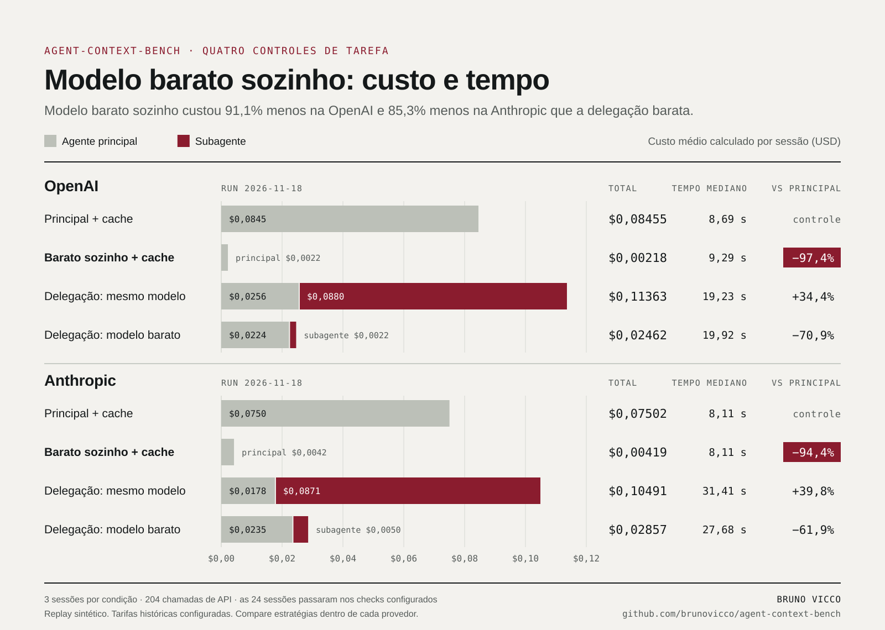

# agent-context-bench

[English](README.md) | **Português (Brasil)**

Quando um agente recebe evidências em vários turnos, em que condições cache, resumo
ou delegação compensam? Um subagente mais barato pode reduzir o custo de uma chamada,
mas acrescenta chamadas ao fluxo e pode dificultar a retenção de uma correção. Medir a
sessão inteira permite comparar custo, latência e qualidade da resposta final.

O `agent-context-bench` é uma CLI em Python que compara essas estratégias em
investigações de incidentes sintéticos na OpenAI e na Anthropic. A ferramenta
contabiliza cada chamada, avalia a resposta final com uma rubrica versionada e
salva os resultados em JSONL e CSV locais. A telemetria é opcional.

[Resultados](#resultados) · [Método e limites](#método-e-limites) ·
[Executar](#executar) · [Reproduzir os resultados publicados](#reproduzir-os-resultados-publicados)

## Resultados

### O modelo sozinho é a referência para comparar delegação

No replay original, as quatro estratégias passaram em todos os critérios nas três
repetições de cada provedor. O modelo mais barato, executado sozinho, teve o menor
custo e terminou mais rápido que o fluxo que delegava para esse mesmo modelo.
Os pares foram GPT-5.6 Sol e GPT-6 Luna na OpenAI, e Sonnet 5.5 e Haiku 5.5
na Anthropic.



O modelo sozinho custou **91,1% menos na OpenAI e 85,3% menos na Anthropic** que
a delegação ao modelo barato. O fluxo delegado mantém o custo do modelo principal
e acrescenta uma chamada ao subagente por turno de evidência. As medianas medem a
sessão inteira.
[Custos e tempos exatos](benchmarks/experiments.pt-br.md#controles-de-tarefa-no-replay-original) ·
[CSV dos resultados](benchmarks/controls-validation.csv) · [Evidências sanitizadas](benchmarks/controls-evidence)

### A agenda de chamadas importa mesmo com cache

Chamar o modelo principal só no turno final reduziu o custo estimado por tarefa
aprovada nas oito comparações com o controle anterior, que respondia a cada turno.
As 24 sessões com `final_only` passaram, igualando o total do controle histórico.
As reduções observadas variaram de **9,68% a 73,52%**. As duas estratégias sem delegação
economizaram mesmo com zero leituras de cache nas rodadas finais. As estratégias
com delegação mantiveram cinco chamadas de processamento de evidência por sessão
e registraram leituras de cache.

### Correções podem falhar no fluxo com delegação

Nos cenários de evidência ambígua, correções repetidas e restrições detalhadas,
**71 de 72 sessões passaram**. A falha ocorreu na Anthropic, com `delegate_small_model`
em `corrections`. Uma nova rodada reproduziu a falha, com os campos de causa e
evidência vazios. Uma verificação separada, feita em memória, encontrou os dois
identificadores exigidos em todos os repasses finais, inclusive nos de quatro
respostas reprovadas. Os identificadores chegaram ao modelo principal, e a
interpretação que ele deu à correção segue em aberto.

Num teste de seis pares, acrescentar a correção original, E5, ao pedido final do
Sonnet elevou as aprovações de **2/6 para 6/6**. Cada par compartilhou a mesma conversa
anterior. As quatro recuperações abrangeram causa e evidência. O teste valida uma
mitigação para o cenário sintético. O mecanismo da falha original segue em aberto.

### Reutilizar notas de status pode compensar seu custo

No experimento histórico de status, reutilizar cada nota três vezes com um modelo
de renderização mais barato reduziu o custo da sessão em **21,2% na OpenAI e 43,5%
na Anthropic**. Com uma atualização na
OpenAI, gerar as notas custou mais que a economia de renderização. Os controles
mais recentes de notas estruturadas e renderização local têm testes offline e
aguardam medição com modelos reais.
[Resultados históricos de status](benchmarks/status-validation.csv)

A [referência dos experimentos](benchmarks/experiments.pt-br.md) reúne tabelas
detalhadas, configurações, testes de acompanhamento e caminhos dos resultados locais.
O pacote público de evidências cobre os controles de tarefa do replay original e os
experimentos anteriores.

## Método e limites

As evidências chegam em cinco turnos. O sexto pede uma resposta JSON. A rubrica
`evidence-v2` verifica a causa confirmada, o identificador da ação, a exigência de
aprovação, a hipótese descartada e os IDs da evidência causal. As estratégias de
uma rodada compartilham cenário e rubrica. A ordem é embaralhada por repetição, e
cada sessão tem prefixos próprios para isolar o contexto.

Os custos incluem os dois papéis e usam as tarifas configuradas na rodada. Um
custo desconhecido fica como `null`. As leituras de cache vêm dos contadores dos
provedores. Use o tempo de sessão para comparar fluxos completos e a latência
por chamada para comparar requisições individuais.

As tarefas sintéticas medem retenção de evidências com conclusões explícitas.
Três repetições por condição dão comparações descritivas. Os provedores usam
modelos e tarifas diferentes, e a comparação de `final_only` usa um controle de
uma rodada anterior. A [referência dos experimentos](benchmarks/experiments.pt-br.md)
descreve a contabilização por provedor e os protocolos completos.

## Executar

Requisitos: Python 3.13 ou 3.14 e `uv`. O núcleo usa SDKs oficiais e arquivos locais;
não precisa de servidor, banco de dados ou framework de agentes.

### Comece sem credenciais

```bash
uv sync --frozen
uv run context-bench demo --output results/demo-01
uv run context-bench report results/demo-01
```

O demo usa respostas fixas, tokens zerados e custos nulos. Serve para verificar a instalação
e o fluxo de arquivos; não produz medidas de desempenho ou qualidade de modelos.

### Execute com as APIs

Disponibilize `OPENAI_API_KEY` e/ou `ANTHROPIC_API_KEY` no ambiente ou em um `.env` local.
Revise os modelos disponíveis na sua conta e as tarifas em `configs/` antes de usar `--live`.
As tarifas dos exemplos são datadas; não representam uma consulta atual de preços.

Para três repetições dos quatro controles de tarefa:

```bash
uv run --env-file .env context-bench run \
  --config configs/openai-controls.toml \
  --output results/openai-controls-NEW --live

uv run --env-file .env context-bench run \
  --config configs/anthropic-controls.toml \
  --output results/anthropic-controls-NEW --live
```

Essas configurações agendam 102 chamadas por provedor. Incluem o modelo barato sozinho,
com o mesmo cenário, política de cache e contrato de saída das outras condições. Use sempre
um diretório novo. As configurações anteriores de três condições continuam disponíveis
como `*-delegation-validation.toml` (84 chamadas por provedor).

Para comparar `full`, `cache` e `summary`, use `configs/openai.toml` ou
`configs/anthropic.toml`. Com três repetições, são 57 chamadas previstas por provedor.

### Leia os resultados

```bash
uv run context-bench report results/openai-controls-NEW
```

| Arquivo local | Conteúdo |
| --- | --- |
| `manifest.json` | Configuração, versões dos SDKs, hashes do cenário e da delegação, ordem e estado do lote |
| `calls.jsonl` | Uso, custo, modelo solicitado/retornado, papel, operação, bytes e latência por chamada |
| `sessions.jsonl` | Estado da sessão, aprovação e resultado de cada verificação |
| `summary.csv` | Agregados por estratégia, incluindo custo por tarefa aprovada |

Para investigar reprovações, adicione `--diagnostics` ao comando `run`. A opção registra
somente os cinco campos avaliados do JSON final, com presença e tipo. Textos têm limite de
256 caracteres e evidências de dez entradas; outros tipos inesperados não têm seu conteúdo salvo.
A opção é desligada por padrão e não altera as requisições nem a avaliação.

```bash
jq '{strategy, passed, checks, answer_diagnostics}' results/SEU_LOTE/sessions.jsonl
```

`Completed` indica que o lote terminou, não que todas as tarefas passaram. Falhas de API
interrompem o lote; os SDKs estão configurados com `max_retries=0`. Saída vazia ou truncada
reprova a sessão. Não há reparo automático de respostas nem retomada do lote interrompido.

## Reproduzir os resultados publicados

```bash
uv run python scripts/reproduce_controls.py
uv run python scripts/reproduce_benchmarks.py
```

Os comandos verificam checksums e contabilização de dois lotes de controles de tarefa
e oito lotes anteriores. Eles reconstroem quatro CSVs sem chamadas de API. Os arquivos
públicos incluem manifestos, uso e critérios de avaliação. Os dados de origem estão nas
[evidências dos controles](benchmarks/controls-evidence) e nos
[lotes históricos](benchmarks/evidence). As tarifas dos controles originais estão
no [registro de proveniência](benchmarks/controls-evidence/provenance.json).

## Desenvolvimento

```bash
uv sync --frozen --all-extras --all-groups
uv run python scripts/quality_gate.py
uv build
```

Os testes com provedores simulados cobrem isolamento de contexto, requisições,
contabilização e recuperação de falhas. A [referência dos experimentos](benchmarks/experiments.pt-br.md)
mostra como regenerar os gráficos e usar telemetria OTLP opcional.

Derivado de [codex-python-engineering-harness](https://github.com/brunovicco/codex-python-engineering-harness),
perfil `library` v1.2.1. [Licença MIT](LICENSE).
